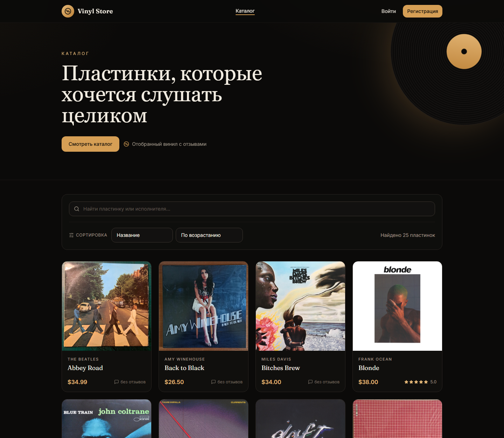

# vinyl-store-frontend

Single-page application for an online vinyl record store, written in TypeScript with React, Vite and Tailwind CSS.


[](https://github.com/lubenkov/vinyl_store_frontend/actions/workflows/ci.yml)
[](./LICENSE)

**Live demo:** <https://vinyl-store-frontend-black.vercel.app> · **API health:** <https://vinyl-store-api.vercel.app/api/health>



## About

The frontend of a vinyl record shop: a catalog with search, sorting and pagination,
a record page with reviews and a purchase flow, email/Google sign-in, a customer
profile, and an admin area for the catalog, Discogs import, Telegram notifications
and the audit log. The UI copy is Russian.

The SPA talks to the separate [vinyl_store](https://github.com/lubenkov/vinyl_store)
REST API. This repository contains no server code and no secrets.

## Features

| Feature        | What it does                                                                                          |
| :------------- | :---------------------------------------------------------------------------------------------------- |
| Catalog        | search by title with an author fallback, sorting, page size and URL-synced state                      |
| Record page    | cover, description, average rating, paginated reviews, review form and a purchase modal               |
| Auth           | email/password and Google OAuth 2.0; the OAuth `state` is checked before the token is accepted         |
| Session        | JWT in `localStorage`; a `401` clears the token and protected routes send the user back to `/login`    |
| Profile        | edit first and last name, see purchase history and own reviews, delete the account                    |
| Admin catalog  | create, edit and delete records; the cover is set by URL                                              |
| Discogs        | preview a release by ID, show its community rating and import it into the catalog                      |
| Telegram       | pick a record and send its card to the configured Telegram chat                                       |
| Logs           | view the backend audit log and filter it client-side                                                   |
| UX             | responsive dark theme, skeleton/empty/error states, toasts and focus-trapped modals                    |
| Security       | CSP and security headers in `vercel.json`; no secrets are shipped in the bundle                       |

## How the code is organised

| File / directory          | Responsibility                                                                 |
| :------------------------ | :----------------------------------------------------------------------------- |
| `src/components/`         | shared UI kit, layout, record cards, cover placeholder and protected routes    |
| `src/context/`            | auth/session and toast providers                                               |
| `src/lib/`                | API client, query client, formatting, debounce, OAuth helpers and class names  |
| `src/pages/`              | catalog, record, auth, profile and 404 pages                                   |
| `src/pages/admin/`        | nested admin area: records, Discogs, Telegram and logs                         |
| `src/types/`              | TypeScript types for API payloads                                              |
| `src/App.tsx`             | route tree                                                                     |
| `.github/workflows/ci.yml` | CI: typecheck, lint, tests and build                                          |
| `vercel.json`             | SPA fallback and security headers                                              |

## Routes

| Path                    | Access   | What it shows                                                        |
| :---------------------- | :------- | :------------------------------------------------------------------- |
| `/`                     | public   | catalog with search, sorting and pagination                          |
| `/vinyls/:id`           | public   | record page, reviews and purchase flow                               |
| `/login`, `/register`   | public   | email/password auth, Google auth and registration                    |
| `/auth/google/callback` | public   | accepts the JWT from the Google OAuth redirect                       |
| `/profile`              | JWT      | profile, purchase history, own reviews and account deletion          |
| `/admin`                | admin    | redirects to `/admin/vinyls`                                         |
| `/admin/vinyls`         | admin    | catalog CRUD                                                         |
| `/admin/discogs`        | admin    | Discogs preview and import by release ID                             |
| `/admin/telegram`       | admin    | send a record card to Telegram                                       |
| `/admin/logs`           | admin    | audit log with a text filter                                         |
| `*` (outside `/admin`)  | public   | 404 page                                                             |

## API

All paths below omit the `/api` prefix. The complete backend contract is documented
in the [vinyl_store README](https://github.com/lubenkov/vinyl_store#api).

| Area        | Endpoints                                                                         |
| :---------- | :-------------------------------------------------------------------------------- |
| Auth        | `POST /auth/register`, `POST /auth/login`, `GET /auth/google`                     |
| Profile     | `GET/PUT/DELETE /users/profile`                                                   |
| Catalog     | `GET /vinyls?limit&offset&sortBy&order&searchBy&searchTerm` → `{ rows, count }`   |
| Record      | `GET /vinyls/:id`, `POST /vinyls`, `PUT/DELETE /vinyls/:id`                       |
| Reviews     | `GET/POST /vinyls/:id/reviews`, `DELETE /reviews/:id`                             |
| Purchase    | `POST /purchases` (`vinylId` and `currency: 'usd'`)                               |
| Discogs     | `GET /discogs/vinyls/:id/scores`, `POST /discogs/vinyls/:id`                      |
| Telegram    | `POST /telegram/sendVinyl`                                                        |
| Logs        | `GET /logs`                                                                       |
| Health      | `GET /health`                                                                     |

The API client lives in `src/lib/api.ts`. It stores the JWT under `vinyl_store_token`,
adds `Authorization: Bearer …` to every request and normalises backend errors into
`ApiError`.

## Build and run

1. Start the backend from [vinyl_store](https://github.com/lubenkov/vinyl_store) on
   `http://localhost:3000` (MySQL, migrations and `.env` are covered in its README).
2. Install dependencies and start the dev server:

```bash
npm install
npm run dev
```

3. Open `http://localhost:5173`.

Vite proxies `/api/*` to `http://localhost:3000` and keeps the prefix, so
`/api/vinyls` becomes `http://localhost:3000/api/vinyls`. The prefix also prevents
the proxy from swallowing the SPA route `/vinyls/:id`.

### Another API address

Create `.env.local`:

```env
VITE_API_URL=http://localhost:3000/api
```

With `VITE_API_URL` set, requests go directly to that origin. For production use the
full API base including `/api`, for example
`https://vinyl-store-api.vercel.app/api`. The value is embedded at build time, so a
new deploy is required after changing it.

## Environment variables

| Variable       | Description                                                                                          |
| :------------- | :--------------------------------------------------------------------------------------------------- |
| `VITE_API_URL` | absolute API base including `/api`; leave empty to use the Vite proxy (`/api` → `http://localhost:3000`) |

This is the only frontend variable. It is public and must never contain secrets.

## Google OAuth

The login and registration pages both show the Google button. The SPA opens
`GET /api/auth/google` with a random `state`; the backend redirects to
`${FRONTEND_URL}/auth/google/callback#accessToken=...&state=...`. The callback page
checks `state` against `sessionStorage`, stores the JWT and removes the hash from
the address bar.

On the backend set `FRONTEND_URL` (the frontend origin, `http://localhost:5173` by
default) and add the Google callback URL to the allowed redirect URIs in Google
Console:

- local: `http://localhost:3000/api/auth/google/callback`
- Vercel: `https://<backend>.vercel.app/api/auth/google/callback`

Existing password accounts are not auto-linked to Google. The backend redirects to
`/login?error=google_account_exists`, and the login page explains that the user
should sign in with the password instead.

## Admin access

Registration always creates the `user` role. To open `/admin`, promote the account
in MySQL and sign in again:

```sql
UPDATE users SET role = 'admin' WHERE email = 'you@example.com';
```

The client-side `ProtectedRoute` is a UX guard only; the API still enforces
`AdminGuard` on every admin endpoint.

## Backend limitations reflected in the UI

1. **Stripe.** `POST /purchases` creates a PaymentIntent but does not return a
   `client_secret`, so Stripe Elements is not connected. The modal shows the created
   order and its status. With `STRIPE_SECRET_KEY=sk_test_dummy` the status is `demo`
   and no money is charged.
2. **Review pagination.** `GET /vinyls/:id/reviews` returns only an array without a
   total, so the “Next” button stays active while the current page is full.
3. **Discogs and Telegram.** The admin actions need real backend credentials. The
   `disabled` values in `.env.example` only skip the Discogs demo seeder; they do not
   make the admin endpoints succeed.
4. **Price and currency.** `price` is a `DECIMAL` in the database and arrives as a
   string; the UI formats it as USD and the purchase currency is fixed to `usd`.
5. **Audit log.** `logs.action` stores the full record JSON. The backend migration
   `20241116000000-fix-logs-action-text.js` changes the column to `TEXT`; apply the
   backend migrations before using the log page on an existing database.
6. **Catalog search.** The backend accepts one `searchBy` column per request. The
   catalog first searches `name`, then falls back to `author` when the name search
   returns nothing.

## Deploy to Vercel

The frontend is a separate static Vercel project; the backend is a separate NestJS
Vercel Function. There is no shared origin or reverse proxy, so the API must be set
as an absolute URL.

1. Import this repository at <https://vercel.com/new>. Vercel detects Vite; keep the
   build command `npm run build` and the output directory `dist`.
2. Add the environment variable in Project Settings → Environment Variables:

```env
VITE_API_URL=https://<backend>.vercel.app/api
```

Set it for both Production and Preview. Otherwise a preview build will call `/api`
on its own domain and receive a 404.

3. On the backend set `FRONTEND_URL=https://<frontend>.vercel.app` and
   `CORS_ORIGINS=https://<frontend>.vercel.app`. Add `https://*.vercel.app` if you
   want preview deployments to work.
4. Add the backend callback
   `https://<backend>.vercel.app/api/auth/google/callback` in Google Console.
5. `vercel.json` already contains the SPA fallback to `index.html`, so deep links
   such as `/vinyls/:id`, `/profile` and `/admin/*` do not return 404. It also sets
   CSP, HSTS, `X-Frame-Options`, `Referrer-Policy` and `Permissions-Policy`.

The first request to the backend function after a quiet period may be slower because
of a cold start.

## Scripts

| Command             | What it does                                      |
| :------------------ | :------------------------------------------------ |
| `npm run dev`       | Vite dev server on `http://localhost:5173`        |
| `npm run build`     | typecheck and build the production bundle to `dist/` |
| `npm run preview`   | serve the production build locally                |
| `npm run typecheck` | `tsc --noEmit`                                    |
| `npm run lint`      | ESLint over the repository                        |
| `npm test`          | run the Vitest suite                              |
| `npm run test:watch`| run Vitest in watch mode                          |

## Tests

`npm test` runs 1 suite with 9 tests: price formatting, Russian pluralisation,
average review score and `ApiError`. CI
(`.github/workflows/ci.yml`) runs `typecheck`, `lint`, `test` and `build` on every
push and pull request to `master` using Node.js 20.

## License

MIT — see [LICENSE](./LICENSE).

<details>
<summary><b>🇷🇺 По-русски</b></summary>

<br>

Фронтенд интернет-магазина виниловых пластинок на React, TypeScript, Vite и
Tailwind CSS. Каталог с поиском, сортировкой и пагинацией, карточка пластинки с
отзывами и покупкой, вход по email и через Google, профиль с историей покупок и
отзывов, админ-панель для CRUD каталога, импорта из Discogs, отправки в Telegram и
журнала действий.

**Запуск:** запустить бэкенд `vinyl_store` на `http://localhost:3000` →
`npm install` → `npm run dev` → открыть `http://localhost:5173`.

**API:** по умолчанию Vite проксирует `/api/*` на `http://localhost:3000`; для
другого адреса задайте `VITE_API_URL` (полный URL вместе с `/api`).

**Проверки:** `npm run typecheck`, `npm run lint`, `npm test`, `npm run build`.

</details>
